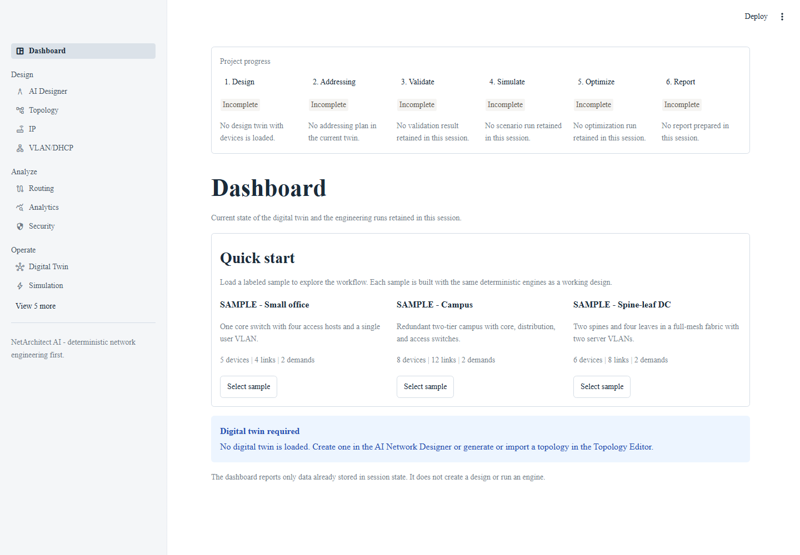
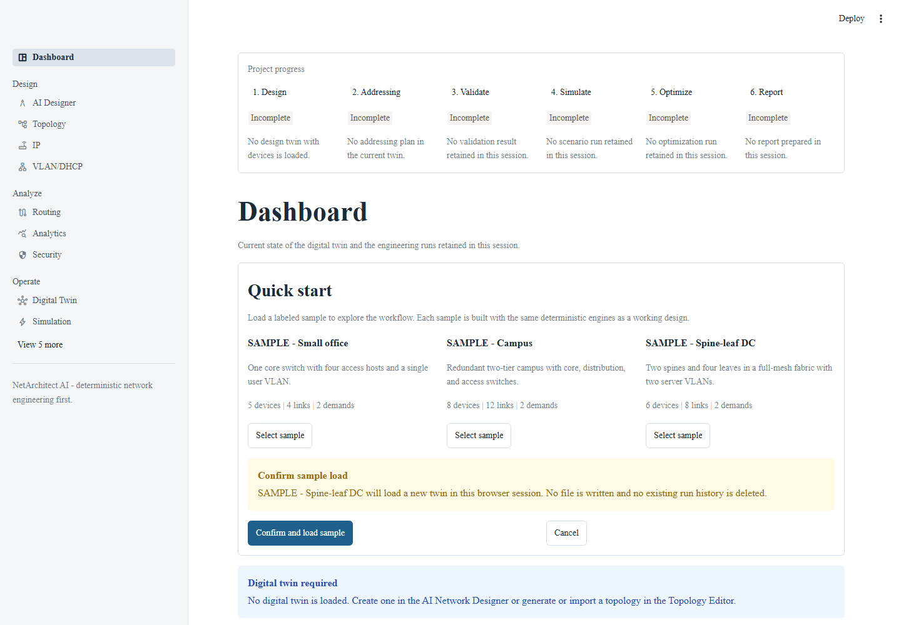
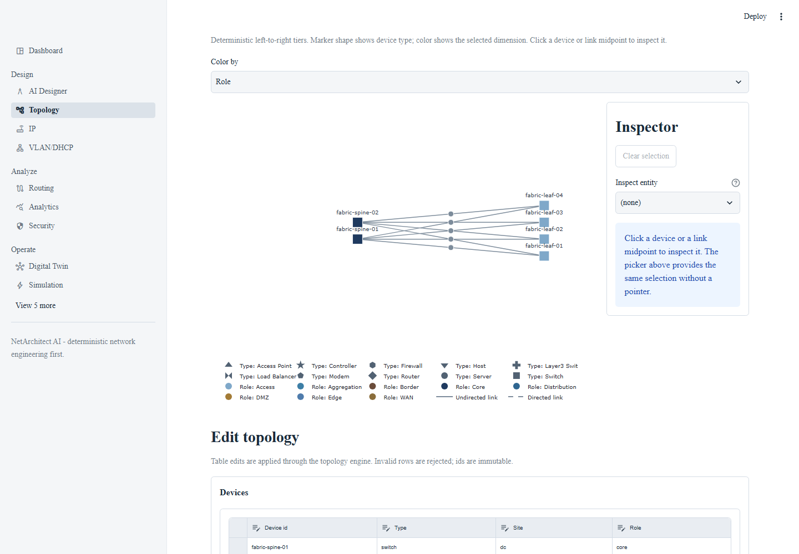
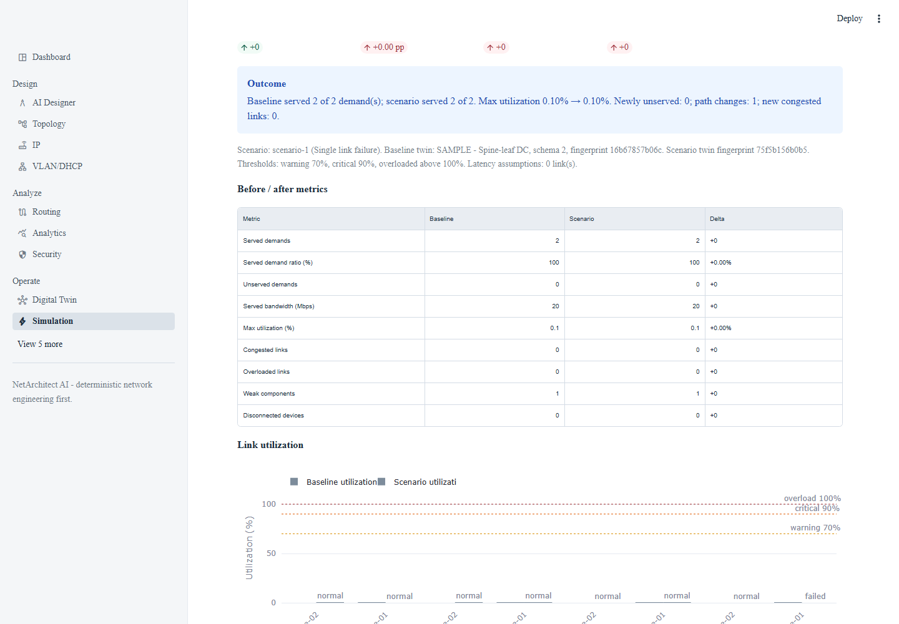
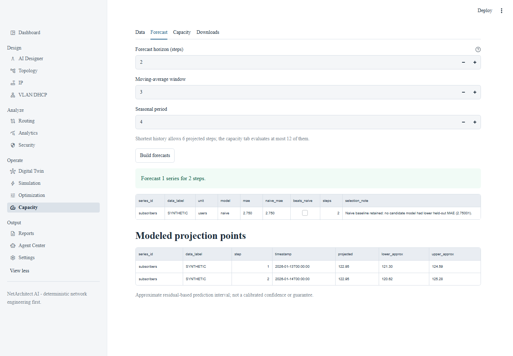
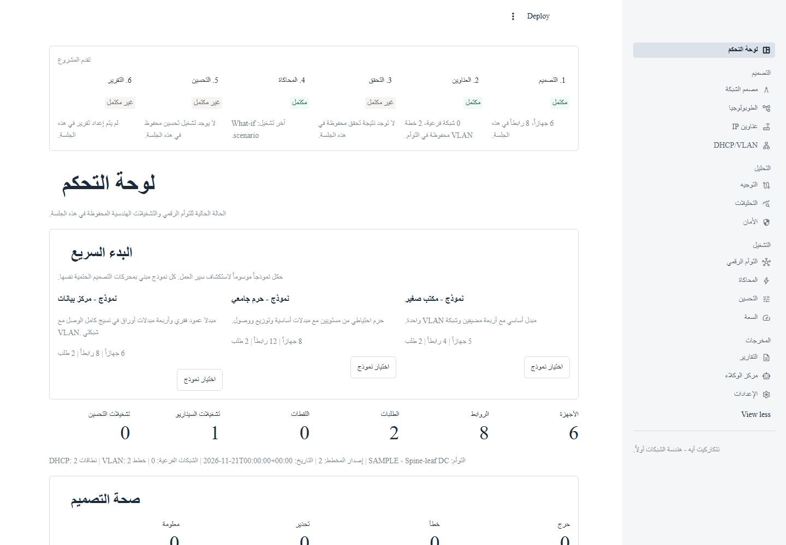

# V2 design package: final verification report

Date: 2026-11-21  
Branch: `feature/v2-design`  
Base: `main` at `ed3312f`  
D1-D5 commits: `3036a3c`, `5d57328`, `e8422eb`, `cef94bf`, `0e7784c`

This package covers the UI design system (D1), guided workflow and sample projects
(D2), layered topology UX (D3), ar/en interface text and RTL (D4), and
accessibility/formatting polish (D5). No engine, schema, export, PDF, state, or
runtime dependency behavior was changed.

## 1. Report files

- `docs/V2_FINAL_REPORT.md`: this report.
- `docs/screenshots/01_dashboard.png`
- `docs/screenshots/02_sample_confirmation.png`
- `docs/screenshots/03_topology.png`
- `docs/screenshots/04_simulation.png`
- `docs/screenshots/05_capacity.png`
- `docs/screenshots/06_dashboard_ar.png`
- `CURRENT_STATUS.md` and `docs/CHANGELOG.md`: updated status and release notes.

## 2. Changed files

### D1 - `3036a3c` design tokens and grouped native navigation

- Config/docs: `.streamlit/config.toml`, `CURRENT_STATUS.md`, `docs/CHANGELOG.md`
- App/navigation: `app.py`, `ui/navigation.py`, `ui/theme.py`, `ui/components/__init__.py`
- Thin page files: `app_pages/agent_center.py`, `app_pages/ai_designer.py`,
  `app_pages/analytics.py`, `app_pages/capacity.py`, `app_pages/dashboard.py`,
  `app_pages/digital_twin.py`, `app_pages/ip_addressing.py`,
  `app_pages/optimization.py`, `app_pages/reports.py`, `app_pages/routing.py`,
  `app_pages/security.py`, `app_pages/settings.py`, `app_pages/simulation.py`,
  `app_pages/topology.py`, `app_pages/vlan_dhcp.py`
- Page adjustments: `ui/pages/dashboard.py`, `ui/pages/optimization_center.py`,
  `ui/pages/routing_analysis.py`, `ui/pages/simulation_lab.py`,
  `ui/pages/topology_editor.py`
- Tests/verification: `scripts/verify_runtime_only.py`,
  `tests/unit/release/test_phase15_acceptance.py`,
  `tests/unit/release/test_phase15_deployment.py`, `tests/unit/ui/nav_helpers.py`,
  `tests/unit/ui/test_agent_control_center_page.py`,
  `tests/unit/ui/test_ai_designer_page.py`, `tests/unit/ui/test_analysis_pages.py`,
  `tests/unit/ui/test_capacity_planning_page.py`,
  `tests/unit/ui/test_dashboard_page.py`, `tests/unit/ui/test_design_system.py`,
  `tests/unit/ui/test_digital_twin_page.py`, `tests/unit/ui/test_navigation.py`,
  `tests/unit/ui/test_optimization_center_page.py`,
  `tests/unit/ui/test_planning_pages.py`, `tests/unit/ui/test_reports_page.py`,
  `tests/unit/ui/test_security_analysis_page.py`,
  `tests/unit/ui/test_settings_page.py`, `tests/unit/ui/test_simulation_lab_page.py`,
  `tests/unit/ui/test_topology_editor.py`

### D2 - `5d57328` project progress and confirmation-gated samples

- `CURRENT_STATUS.md`, `docs/CHANGELOG.md`, `app.py`
- New UI modules: `ui/progress.py`, `ui/sample_projects.py`
- State/page changes: `ui/state.py`, `ui/pages/dashboard.py`, `ui/pages/ip_addressing.py`
- Tests: `tests/unit/ui/test_progress.py`, `tests/unit/ui/test_sample_projects.py`

### D3 - `e8422eb` layered topology diagram and inspector

- New UI module: `ui/topology_view.py`
- Page change: `ui/pages/topology_editor.py`
- Test: `tests/unit/ui/test_topology_view.py`
- Docs: `CURRENT_STATUS.md`, `docs/CHANGELOG.md`

### D4 - `cef94bf` ar/en catalog and RTL

- New catalog: `ui/i18n.py`
- App/shared UI: `app.py`, `ui/navigation.py`, `ui/components/__init__.py`,
  `ui/components/health.py`, `ui/progress.py`, `ui/topology_view.py`
- Pages: `ui/pages/dashboard.py`, `ui/pages/settings.py`
- Tests: `tests/unit/ui/test_i18n.py`,
  `tests/unit/release/test_phase15_deployment.py`
- Docs: `CURRENT_STATUS.md`, `docs/CHANGELOG.md`

### D5 - `0e7784c` accessibility and consistent formatting

- New helpers: `ui/formatting.py`, `ui/components/feedback.py`
- Catalog keys: `ui/i18n.py`
- Pages/views: `ui/pages/ai_designer.py`, `ui/pages/capacity_planning.py`,
  `ui/pages/dashboard.py`, `ui/pages/digital_twin.py`,
  `ui/pages/optimization_center.py`, `ui/pages/security_analysis.py`,
  `ui/pages/settings.py`, `ui/pages/simulation_lab.py`, `ui/topology_view.py`
- Test: `tests/unit/ui/test_d5_accessibility.py`
- Docs: `CURRENT_STATUS.md`, `docs/CHANGELOG.md`

Final report commit adds this report, the six screenshots under
`docs/screenshots/`, and final status/changelog updates.

## 3. Verbatim verification output

### `pytest -q`

```text
........................................................................ [  6%]
........................................................................ [ 13%]
........................................................................ [ 20%]
........................................................................ [ 27%]
........................................................................ [ 34%]
........................................................................ [ 41%]
........................................................................ [ 48%]
........................................................................ [ 54%]
........................................................................ [ 61%]
........................................................................ [ 68%]
........................................................................ [ 75%]
........................................................................ [ 82%]
........................................................................ [ 89%]
........................................................................ [ 96%]
........................................                                 [100%]
1048 passed, 3 deselected in 36.15s
```

### `ruff check .`

```text
All checks passed!
```

### `pytest -q -m smoke`

```text
............                                                             [100%]
12 passed, 1039 deselected in 5.46s
```

### `scripts/profile_imports.py`

```text
2026-11-21 01:38:15.567 WARNING streamlit.runtime.scriptrunner_utils.script_run_context: Thread 'MainThread': missing ScriptRunContext! This warning can be ignored when running in bare mode.
| import target | cumulative us |
| --- | ---: |
| reportlab | 0 |
| services.reporting | 0 |
| services.export | 0 |
| ui.pages.reports | 0 |
| ui.pages.agent_control_center | 0 |
| ui.pages.ai_designer | 0 |
| ui.pages.security_analysis | 0 |
| app (total cumulative) | 1459589 |

| measurement | seconds |
| --- | ---: |
| Dashboard first render | 1.340 |
```

The Streamlit warning is expected when `profile_imports.py` runs outside
`streamlit run`. The final profile was rerun after stopping the browser and the
live Streamlit server so background process load would not distort the numbers.

### Runtime-only venv: `scripts/verify_runtime_only.py --port 8609`

```text
2026-11-21 01:38:25.376 WARNING streamlit.runtime.caching.cache_data_api: No runtime found, using MemoryCacheStorageManager
2026-11-21 01:38:25.377 WARNING streamlit.runtime.caching.cache_data_api: No runtime found, using MemoryCacheStorageManager
2026-11-21 01:38:25.378 WARNING streamlit.runtime.caching.cache_data_api: No runtime found, using MemoryCacheStorageManager
2026-11-21 01:38:25.378 WARNING streamlit.runtime.caching.cache_data_api: No runtime found, using MemoryCacheStorageManager
2026-11-21 01:38:25.379 WARNING streamlit.runtime.caching.cache_data_api: No runtime found, using MemoryCacheStorageManager
2026-11-21 01:38:25.380 WARNING streamlit.runtime.caching.cache_data_api: No runtime found, using MemoryCacheStorageManager
2026-11-21 01:38:25.382 WARNING streamlit.runtime.scriptrunner_utils.script_run_context: Thread 'MainThread': missing ScriptRunContext! This warning can be ignored when running in bare mode.
health: ok; root status: 200
AppTest rendered 15 pages with no exceptions
runtime-only verification: PASS (pytest not installed)
```

The `MemoryCacheStorageManager` and missing-`ScriptRunContext` warnings are
expected in the bare runtime-only verification process.

### Requirements invariants

```text
first: streamlit==1.67.0
count: 9
bad_directives: []
all_exact_pins: True
pyarrow_inline: ['pyarrow==23.0.1']
```

## 4. Dashboard first render: before/after

| Measurement | Before D1 | Final package | Change |
| --- | ---: | ---: | ---: |
| `app` total cumulative import time | 1,550,415 us | 1,459,589 us | -90,826 us (-5.9%) |
| Dashboard first render | 1.357 s | 1.340 s | -0.017 s (-1.3%) |

These are single-run local measurements from `scripts/profile_imports.py` on the
same Windows host. They show no regression from the D1-D5 UI package. They are
not a substitute for a deployed Linux Community Cloud cold-start measurement.

## 5. Browser screens (exactly 6)

All six screens were captured from real headless Chrome against
`http://localhost:8607/` at 1440x1000. Each PNG was confirmed nonblank by pixel
statistics and readable by OCR/DOM text checks. The live Streamlit server and
Chrome/CDP processes were stopped after capture.

### 5.1 Dashboard initial state



Shows Dashboard first in navigation, grouped sections, the six-step progress
strip, three labeled sample projects, and the explicit "dashboard reports only
session data" notice.

### 5.2 Confirmation-gated sample load



Shows the pending `SAMPLE - Spine-leaf DC` confirmation with explicit
"Confirm and load sample" / "Cancel" actions and no file-write claim.

### 5.3 Layered topology



Shows the loaded spine-leaf twin, deterministic tiers, device-type markers,
legend, color controls, and keyboard-reachable inspector selection.

### 5.4 Simulation result with visible congestion semantics



Shows a deterministic single-link-failure run, formatted metrics, visible
`normal`/`failed` labels on utilization bars, and the bounded session history.

### 5.5 Capacity forecast



Shows a synthetic series forecast with explicit model notes, formatted values,
and full-width forecast tables.

### 5.6 Arabic RTL dashboard



Shows session-only Arabic text, document-level RTL direction, LTR-isolated
engineering tokens/numerics, loaded real session data, and localized progress.

## 6. What was NOT verified

- Deployment to Streamlit Community Cloud or any remote public URL.
- Remote GitHub Actions execution; only local equivalents of the commands were run.
- Deployed Linux RSS against the 450 MB gate in `scripts/check_linux_memory.py`.
- Live Groq/provider responses, real API keys, or network timeouts; no key was
  configured and no live provider call was made in this package.
- PDF visual layout or export rendering beyond the existing automated tests. The
  PDF/export code path was not changed.
- Manual human visual inspection of every screenshot pixel. The screens were
  checked programmatically for blank content, dimensions, DOM text, and OCR; the
  Arabic screenshot's RTL word order is naturally noisy in OCR.
- Viewports narrower than 1440x1000. The six captures are desktop-width only;
  responsive behavior below that width was not exercised in this browser pass.
- Manual keyboard tab traversal in a browser. Keyboard reachability is enforced
  by visible-label/control tests and the topology picker, not by a recorded
  tab-order walkthrough.
